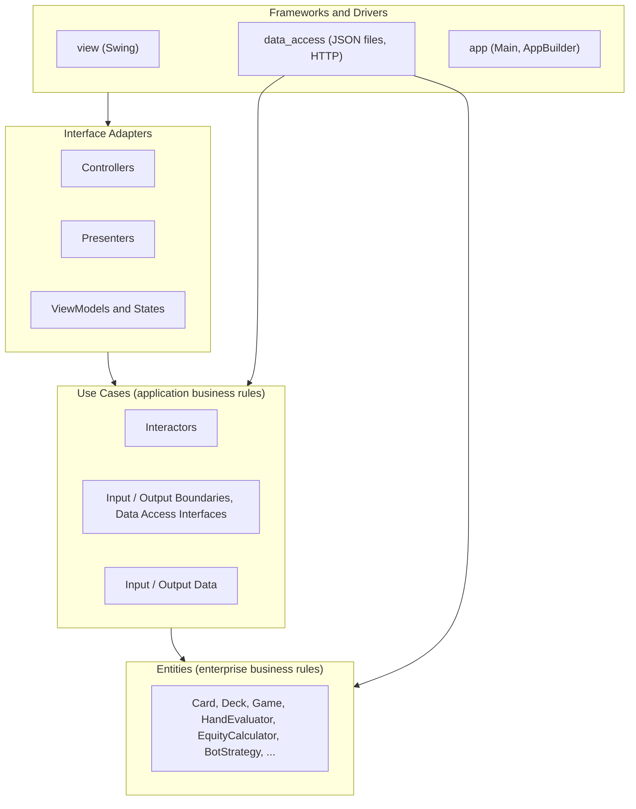
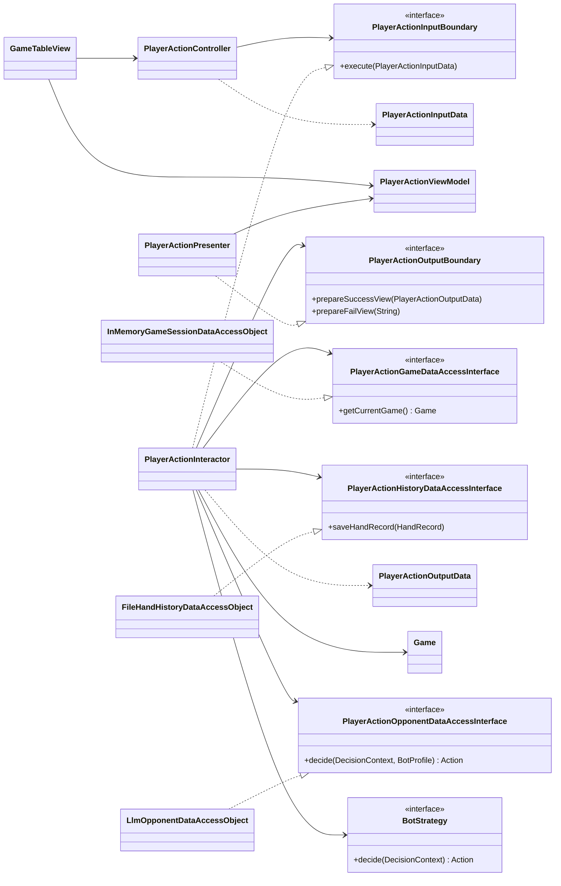
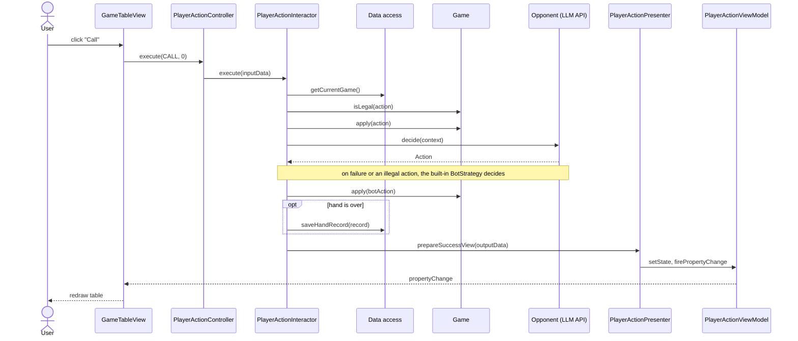

# Architecture

> **Status: draft proposal, not yet agreed by the team.**
> Nothing here is implemented except the package skeleton on `main` and the
> `Card` / `Deck` entities in PR #4. Items marked **(decision needed)** are open.

This document describes how the poker application is organised so that it
follows Clean Architecture (CA) as taught in CSC207 (course notes ch. 10–11,
week 7 lecture) and meets the project rubric and timeline.

## 1. Scope and assumptions

| Topic | Assumption |
|---|---|
| Game | Heads-up (one human vs. one computer) No-Limit Texas Hold'em **(decision needed — the README only says "poker")** |
| UI | Java Swing desktop application |
| Build | Maven, Java 11 (as in the current `pom.xml`) |
| Persistence | Local JSON files |
| External API | A large language model (LLM) API that plays the computer opponent; provider not chosen **(decision needed — see §8)** |
| Team | 4 members |

## 2. How the design maps to course requirements

| Requirement (source) | Where it is addressed |
|---|---|
| Layered design following CA, no Dependency Rule violations (rubric: Clean Architecture, /10) | §4 layers, §5 package layout, §9 dependency rules |
| Diagrams that convey the architecture (rubric; README template "Design Diagrams") | §4, §7.2, §7.3 |
| Each member leads at least one significant, non-overlapping use case (rubric: Project scope; Milestone 1) | §3 |
| Core entities designed and implemented (Milestone 1) | §6 |
| API usage that is motivated by the program (rubric: API usage) | §3 UC2, §8 |
| Data persistence, both saving and loading demonstrated (rubric: Data Persistence) | §3 UC3 and UC4, §8 |
| SOLID discussion and a design pattern beyond the starter code (rubric: Overall Design, /10) | §10 |
| One unit test per interactor (Milestone 3); 100% line coverage of Entity and Use Case layers (Milestone 4) | §11 |
| Checkstyle or similar in use (rubric: Code quality, needed for 4/5 and above) | §11 |

## 3. Use cases (MVP)

The four user stories in the README become five use cases. Each has its own
package in `use_case` and `interface_adapter`.

| # | Use case | Package name | User story | Suggested lead |
|---|---|---|---|---|
| UC1 | Start a new hand | `start_hand` | Play against the computer | TBD |
| UC2 | Take a betting action | `player_action` | Play against the computer | TBD |
| UC3 | Configure the computer opponent | `configure_bot` | Modify the computer's behaviour | TBD |
| UC4 | Review past hands | `view_history` | Review previous games | TBD |
| UC5 | Calculate equity for a scenario | `calculate_equity` | See the winning chance | TBD |

With four members and four user stories, the proposed split is one user story
per member: one member leads UC1 + UC2 (the game loop), and the other three
lead UC3, UC4, and UC5 respectively. Who takes which is to be agreed. Every
member must lead at least one.

### UC1 — Start a new hand

1. The user chooses to start a hand.
2. The system shuffles the deck, posts blinds, and deals two hole cards to each player.
3. The system shows the user's cards, both stacks, the pot, and the actions the user may take.
4. If either player has no chips left, the system reports that the match is over instead.

### UC2 — Take a betting action

1. The user chooses fold, check, call, bet, or raise (with an amount where relevant).
2. If the action is not legal in the current state, the system tells the user why and nothing changes.
3. Otherwise the system applies the action, then lets the computer act according to its current configuration.
4. When a betting round ends, the system reveals the next community cards.
5. When the hand ends (a fold, or showdown after the river), the system announces the winner, moves the pot, and saves a record of the hand.

### UC3 — Configure the computer opponent

1. The user opens the opponent settings and sees the current configuration.
2. The user picks a playing style and adjusts its parameters.
3. The system saves the configuration; it is used from the next hand on and is still there after the program restarts.

### UC4 — Review past hands

1. The user opens the history and sees a list of previously played hands (date, result, chips won or lost).
2. The user selects a hand.
3. The system shows that hand's hole cards, community cards, every action in order, and the outcome.
4. If there is no history yet, the system says so.

### UC5 — Calculate equity for a scenario

1. The user enters their hole cards and zero to five community cards.
2. If the input is invalid (duplicate card, wrong number of cards), the system tells the user.
3. Otherwise the system shows the win, tie, and loss probabilities, based only on the cards the user entered.

## 4. Layers

Dependencies point inward only. Inner layers never name anything declared in
an outer layer; where control must flow outward, the inner layer declares an
interface and the outer layer implements it (Dependency Inversion).



| Layer | Package | Contains | Policy level |
|---|---|---|---|
| Entities | `entity` | Poker rules and data that would be true for any poker program | Highest |
| Use Cases | `use_case.<name>` | One interactor per use case, its boundaries, its data-access interface, input and output data | Medium |
| Interface Adapters | `interface_adapter.<name>` | Controller, Presenter, ViewModel, State | Lower |
| Frameworks and Drivers | `view`, `data_access` | Swing screens; file and HTTP access | Lowest |
| Main component | `app` | Builds every object and wires them together | n/a |

## 5. Package layout

```text
src/main/java/
├── app/
│   ├── Main.java                         entry point; calls AppBuilder
│   └── AppBuilder.java                   creates and connects views, use cases, DAOs
├── entity/
│   ├── Rank.java, Suit.java              enums
│   ├── CardState.java                    enum: where a card currently is
│   ├── Card.java, Deck.java
│   ├── HoleCards.java                    one player's two cards
│   ├── Board.java                        the five community cards
│   ├── HandCategory.java                 enum: HIGH_CARD ... STRAIGHT_FLUSH
│   ├── HandValue.java                    comparable strength of a 5-card hand
│   ├── HandEvaluator.java                best 5 of 7 cards
│   ├── EquityCalculator.java             chance of winning from the visible cards
│   ├── EquityResult.java                 chances of winning, tying, and losing
│   ├── PreflopEquityTable.java           chances before the flop for the 169 starting hands
│   ├── Player.java
│   ├── ActionType.java, Action.java
│   ├── Street.java                       enum: PREFLOP, FLOP, TURN, RIVER, SHOWDOWN
│   ├── Game.java                         state and rules of one hand
│   ├── HandRecord.java                   immutable record of a finished hand
│   ├── BotProfile.java                   chosen style and its parameters
│   ├── DecisionContext.java              what the computer opponent may look at
│   ├── BotStrategy.java                  interface for the built-in opponent
│   └── strategy/                         rule-based implementations of BotStrategy
├── use_case/
│   ├── start_hand/
│   ├── player_action/
│   ├── configure_bot/
│   ├── view_history/
│   └── calculate_equity/
├── interface_adapter/
│   ├── ViewModel.java                    generic base with property-change support
│   ├── ViewManagerModel.java             which screen is showing
│   ├── start_hand/
│   ├── player_action/
│   ├── configure_bot/
│   ├── view_history/
│   └── calculate_equity/
├── data_access/
│   ├── InMemoryGameSessionDataAccessObject.java
│   ├── FileHandHistoryDataAccessObject.java
│   ├── InMemoryHandHistoryDataAccessObject.java   for tests
│   ├── FileBotProfileDataAccessObject.java
│   └── LlmOpponentDataAccessObject.java           calls the LLM API
└── view/
    ├── ViewManager.java
    ├── MainMenuView.java
    ├── GameTableView.java
    ├── BotSettingsView.java
    ├── HistoryView.java
    └── EquityView.java

src/test/java/
├── entity/                               one test class per entity
└── use_case/<name>/                      one test class per interactor
```

Every `use_case/<name>/` package has the same kinds of file, shown here for
`player_action`. A use case that stores and loads nothing, such as
`calculate_equity`, has no data-access interface.

| File | Kind | Role |
|---|---|---|
| `PlayerActionInputBoundary` | interface | What the controller calls. `void execute(PlayerActionInputData)` |
| `PlayerActionInputData` | class | The requested action and amount |
| `PlayerActionInteractor` | class | Implements the input boundary; runs the use case |
| `PlayerActionOutputBoundary` | interface | `prepareSuccessView(...)`, `prepareFailView(String)` |
| `PlayerActionOutputData` | class | What changed, in plain types |
| `PlayerAction...DataAccessInterface` | interface | Exactly the persistence methods this use case needs. One interface per store: this use case has `PlayerActionGameDataAccessInterface` and `PlayerActionHistoryDataAccessInterface`; most use cases have a single one |

Every `interface_adapter/<name>/` package has `<Name>Controller`,
`<Name>Presenter`, `<Name>ViewModel`, and `<Name>State`.

The placeholder files `exampleclass_data_access`, `exampleclass_interface_adapter`,
and `exampleclass_use_case` should be deleted once real classes exist, and a
`view` package added.

## 6. Entities

| Entity | Data | Rules it enforces |
|---|---|---|
| `Rank`, `Suit` | enum constants | Only 13 ranks and 4 suits exist; ranks are ordered from `TWO` up to `ACE`, suits have no order |
| `CardState` | enum constants | A card is in the deck, in a hand, a face-down community card, or a face-up community card |
| `Card` | rank, suit, state | Rank and suit never change. The state changes only through `dealToHand()`, `dealToBoard()`, `reveal()`, and `returnToDeck()`, each of which rejects a move that is not allowed from the current state. Two cards are equal when rank and suit both match; the state is not compared. `Card` has no ordering of its own: cards are sorted by comparing `Rank`, and hands are compared through `HandValue` |
| `Deck` | all 52 cards, position of the next card to deal | 52 distinct cards, created once and kept for the whole game; `shuffle(Random)`; dealing changes the card's state instead of removing it and fails when no cards are left; `cardsIn(CardState)` lists the cards in a given state |
| `HoleCards` | two cards | Exactly two different cards, both dealt to a hand |
| `Board` | five cards | Five different cards dealt face down; revealed only in the order flop, turn, river; only the revealed cards can be read |
| `HandValue` | category, tie-break ranks | Total ordering of 5-card hands |
| `HandEvaluator` | none | Best 5-card hand out of 5 to 7 cards. Also gives the strength as a single number, for code that compares very many hands |
| `Player` | name, stack, `HoleCards`, folded flag | Cannot bet more than the stack; stack never negative. `winChance(board)` gives its chances of winning, tying, and losing from the cards it can see (its hole cards and the revealed community cards) and from nothing else |
| `Action` | type, amount | Amount present only for bet and raise |
| `Game` | two players, `Board`, pot, street, bets in the current round, whose turn, log of events | One hand of heads-up No-Limit Texas Hold'em. Both players need at least the big blind to start. Decides which actions are legal, the minimum raise, when a betting round ends, and who wins the pot; returns the unmatched part of a bet when a player is all-in for less; runs out the board when a player is all-in; gives an odd chip of a split pot to the big blind |
| `HandRecord` | id, timestamp, player names, hole cards, board, ordered events, winner, chip changes | Immutable once created. Cards are stored as text, so a record does not change when the same cards are dealt again |
| `EquityCalculator` | none | Win, tie, and loss chances given hole cards and revealed community cards; every other card is treated as unknown. Exact from the flop on; before the flop it reads `PreflopEquityTable` |
| `PreflopEquityTable` | win and tie chances for the 169 kinds of starting hand | Worked out ahead of time by simulation; each number is accurate to about 0.0003 |
| `EquityResult` | win, tie, lose | Each chance is between 0 and 1 |
| `BotProfile` | playing style name, aggression | Aggression stays between 0 and 1 |
| `DecisionContext` | hole cards, revealed board, pot, amount to call, legal actions, smallest and largest bet or raise, chance of winning | Holds only what the computer player can see |
| `BotStrategy` | none (interface) | The built-in opponent: `Action decide(DecisionContext)` returns a legal action without any network access |

Where a card is during a hand is recorded on the card itself, as its
`CardState`. `Deck`, `HoleCards`, and `Board` all hold references to the same
52 `Card` objects; dealing and revealing move a card from one state to the
next. Because the cards are reused from hand to hand, anything that must
outlive a hand, such as `HandRecord`, stores card text and not the cards.

The chance of winning is always computed from one player's point of view, as
a method of `Player`. It takes the revealed community cards as its argument
and treats every other card as unknown, so it cannot use the opponent's hole
cards or cards that have not been dealt. UC5 uses the same method: the
interactor builds a `Player` holding the hole cards the user entered, together
with the community cards the user entered, and asks that player for its chance
of winning. The computation is local and needs no network access.

The opponent is assumed to hold any two of the unknown cards with equal
likelihood. How the chances are worked out depends on the betting round:

| Round | Method | Cases | Time measured |
|---|---|---|---|
| Before the flop | Look up `PreflopEquityTable` | 169 entries | immediate |
| Flop | Count every case | 1081 × 990 = 1,070,190 | about 40 ms |
| Turn | Count every case | 46 × 990 = 45,540 | about 2 ms |
| River | Count every case | 990 | under 1 ms |

From the flop on the result is exact. Before the flop there are about two
billion cases per hand, too many to count during a game, but the chances then
depend only on the two ranks and whether the cards share a suit, so a table of
169 entries covers every starting hand. The table was produced ahead of time
by `PreflopEquityTableGenerator` (in the test sources) from 20 million random
deals per entry with a fixed seed.

The method on `Player` is the entry point, `player.winChance(board)`. The
simulation and hand comparison themselves live in `EquityCalculator`, which the
method calls, so `Player` stays small and the algorithm can be tested on its own.

The computer opponent has two sources of decisions. The main one is the LLM
API, reached through an interface that the use case declares (§8). The other
is the built-in `BotStrategy` in this layer, which needs no network and is
used when the API is unavailable and in unit tests. Both are given the same
`DecisionContext`, which the interactor fills with only what the computer
player can see.

## 7. Flow of control

### 7.1 Steps (UC2 as the example)

1. `GameTableView` handles the button click and calls `PlayerActionController.execute(type, amount)`.
2. The controller builds `PlayerActionInputData` and calls `PlayerActionInputBoundary.execute`.
3. `PlayerActionInteractor` gets the current `Game` through `PlayerActionGameDataAccessInterface`.
4. It asks `Game` whether the action is legal. If not, it calls `prepareFailView` and stops.
5. It applies the action, then asks `PlayerActionOpponentDataAccessInterface` for the computer's action. If that call fails, or the returned action is not legal, it asks the built-in `BotStrategy` instead. It applies the computer's action and advances the street if the round is over.
6. If the hand is over it builds a `HandRecord` and saves it through `PlayerActionHistoryDataAccessInterface`.
7. It builds `PlayerActionOutputData` and calls `PlayerActionOutputBoundary.prepareSuccessView`.
8. `PlayerActionPresenter` turns the output data into display strings, updates `PlayerActionState` in the view model, and fires a property change.
9. `GameTableView`, which listens to the view model, redraws.

Nothing is returned to the controller; results travel only through the output boundary.

### 7.2 Class diagram for one use case



The five `PlayerAction...` interfaces belong to the use case layer.
`PlayerActionPresenter` and the three data access objects are outer-layer
classes that implement them,
which is where Dependency Inversion keeps the arrows pointing inward.

### 7.3 Sequence diagram



## 8. Data access and the API

Each interactor declares its own small data-access interface. One concrete
class may implement several of them.

| Concrete class | Implements the interface of | Storage |
|---|---|---|
| `InMemoryGameSessionDataAccessObject` | `start_hand`, `player_action` | Holds the current `Game` while the program runs |
| `FileHandHistoryDataAccessObject` | `player_action` (save), `view_history` (load) | `data/hand_history.json` |
| `FileBotProfileDataAccessObject` | `configure_bot` (save, load), `player_action` (load) | `data/bot_profile.json` |
| `LlmOpponentDataAccessObject` | `player_action` (the computer's decision) | HTTP request to the LLM API |
| `InMemoryHandHistoryDataAccessObject` | same as the file version | Used in unit tests |

Saving and loading are both visible to the user: hand history survives a
restart (UC4) and so does the opponent configuration (UC3).

**API.** The external API is an LLM that plays the computer opponent. The
chance of winning is computed locally (§6) and does not use it.

- Only `LlmOpponentDataAccessObject` knows the provider, the URL, the prompt,
  and the response format. It turns the `DecisionContext` and `BotProfile` into
  a request and the reply into an `Action`.
- The request contains only what is in `DecisionContext`, so the model never
  sees the human's hole cards or undealt cards.
- The playing style in `BotProfile` (UC3) becomes part of the prompt.
- The interactor checks the returned action with the same legality check it
  uses for the human's action. On a failed call, a timeout, or an illegal
  action, the built-in `BotStrategy` decides instead.
- The API key is read from an environment variable or a local file that is
  listed in `.gitignore`; it is never committed. Without a key the program
  still runs, using the built-in opponent.
- The request takes noticeable time, so the view must not wait for it on the
  Swing event thread.

Still to decide: which provider, and whether the course permits LLM APIs
(to be confirmed with the TA).

**Libraries (decision needed).** `pom.xml` currently has no dependencies.
Needed: JUnit 5 for tests, a JSON library, and an HTTP client. These may only
be imported inside `data_access` (and JUnit inside `src/test`).

## 9. Dependency rules

| Code in | May import | Must not import |
|---|---|---|
| `entity` | `entity`, `java.util` | everything else, including Swing, JSON, HTTP |
| `use_case.<x>` | `entity`, its own package | `interface_adapter`, `view`, `data_access`, `app`, Swing, JSON, HTTP |
| `interface_adapter.<x>` | `use_case.<x>`, `interface_adapter` | `entity` where avoidable, `view`, `data_access`, `app` |
| `view` | `interface_adapter`, Swing | `use_case` interactors, `entity`, `data_access` |
| `data_access` | `use_case.<x>` interfaces, `entity`, JSON and HTTP libraries | `interface_adapter`, `view` |
| `app` | everything | n/a |

Further rules:

- Input and output data carry only strings, numbers, booleans, and lists of
  those. Entities do not cross the boundary to presenters or views.
- Input boundary methods return `void`.
- One use case does not call another use case's interactor.
- To check: read the `import` lines at the top of each file, or generate a
  dependency graph in IntelliJ.

## 10. SOLID and design patterns

| Principle | Where it shows in this design |
|---|---|
| Single Responsibility | One interactor per use case; presenters only format; `HandEvaluator` only ranks hands |
| Open/Closed | A different opponent (another LLM provider, a new built-in style) is a new class implementing an existing interface; `Game` and the interactors are unchanged |
| Liskov Substitution | Any opponent implementation, and the file or in-memory DAO, can be swapped without the interactor noticing |
| Interface Segregation | Each use case has its own data-access interface with only the methods it uses |
| Dependency Inversion | Interactors depend on boundaries and data-access interfaces; outer layers implement them |

Design patterns:

- **Strategy** — the computer's decision is behind an interface with
  interchangeable implementations: the LLM-backed one and the built-in
  `BotStrategy` classes. This is the main pattern added beyond the course
  starter code and is also the clearest extensibility example for the
  presentation.
- **Simple factory** — one place that turns a `BotProfile` into the built-in `BotStrategy`.
- **Observer** — views listen to view models through property-change events
  (already part of the course's CA example).
- **Builder** — `AppBuilder` assembles the application (also in the course example).

The rubric's top band asks for a pattern not presented in class; which
patterns count needs to be checked against the lecture list.

## 11. Testing and code quality

- **Entities**: one JUnit test class per entity. `HandEvaluator` needs a case
  for every hand category and for tie-breaks. `Deck` tests use a seeded `Random`.
- **Interactors**: one test class per interactor, using the in-memory DAOs, a
  scripted stand-in for the opponent interface, and a small test implementation
  of the output boundary that records what it was given. No Swing, files, or
  network in these tests; the LLM is never called from a test.
- **Target**: at least one test per interactor by Milestone 3; 100% line
  coverage of `entity` and `use_case` by Milestone 4.
- **Style**: Checkstyle (CheckStyle-IDEA plugin, optionally the Maven plugin)
  run before each pull request. Class names in `UpperCamelCase`.
- **Pull requests**: one use case, or one layer of one use case, per PR; another
  member reviews before merge.

## 12. Order of work

| Milestone | Due | Architecture work |
|---|---|---|
| 1 | Fri Nov 13 | Agree on §1 and §3; move use cases and the MVP table into the README; finish `Card`, `Deck`, `Player`, `Action`, `Game`, `HandEvaluator`; first interactor and view stubs |
| 2 | Fri Nov 20 | One use case working end to end (UC1 is the smallest); `AppBuilder`; a runnable call to the chosen API; each member has a substantial PR and a review |
| 3 | Fri Nov 27 | All five use cases integrated; one unit test per interactor |
| 4 | Fri Dec 4 | 100% line coverage of `entity` and `use_case`; Checkstyle evidence; diagrams for the slides |
| Presentation | Dec 7/8 | |

## 13. Open decisions

1. Which poker variant, and is the match heads-up only?
2. Which LLM provider to use, and confirmation from the TA that an LLM API is allowed.
3. Who leads which use case.
4. JSON and HTTP libraries.
5. Unit tests and Checkstyle for the entity layer.
