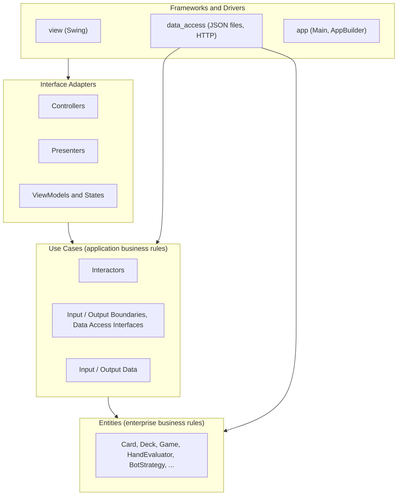
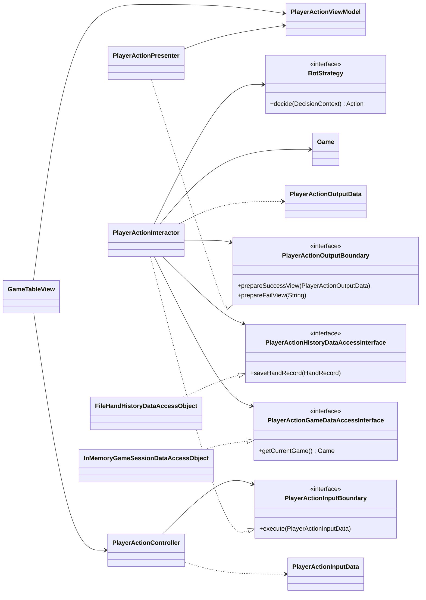
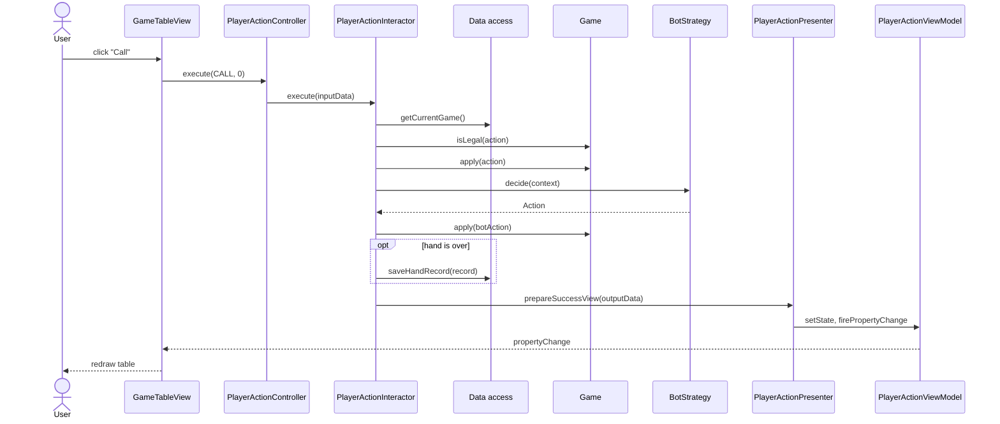

# Architecture

> **Status: draft proposal, not yet agreed by the team.**
> Nothing here is implemented except the package skeleton on `main` and the
> `Card` / `Deck` entities in PR #4. Items marked **(decision needed)** are open.

This document describes how the poker application is organised so that it
follows Clean Architecture (CA) as taught in CSC207 (course notes ch. 10–11,
week 7 lecture) and meets the project rubric and timeline.

## 1. Scope and assumptions

| Topic | Assumption |
|---|---|
| Game | Heads-up (one human vs. one computer) No-Limit Texas Hold'em **(decision needed — the README only says "poker")** |
| UI | Java Swing desktop application |
| Build | Maven, Java 11 (as in the current `pom.xml`) |
| Persistence | Local JSON files |
| External API | A poker equity / hand-evaluation web API **(decision needed — see §8)** |
| Team | 2 members |

## 2. How the design maps to course requirements

| Requirement (source) | Where it is addressed |
|---|---|
| Layered design following CA, no Dependency Rule violations (rubric: Clean Architecture, /10) | §4 layers, §5 package layout, §9 dependency rules |
| Diagrams that convey the architecture (rubric; README template "Design Diagrams") | §4, §7.2, §7.3 |
| Each member leads at least one significant, non-overlapping use case (rubric: Project scope; Milestone 1) | §3 |
| Core entities designed and implemented (Milestone 1) | §6 |
| API usage that is motivated by the program (rubric: API usage) | §3 UC5, §8 |
| Data persistence, both saving and loading demonstrated (rubric: Data Persistence) | §3 UC3 and UC4, §8 |
| SOLID discussion and a design pattern beyond the starter code (rubric: Overall Design, /10) | §10 |
| One unit test per interactor (Milestone 3); 100% line coverage of Entity and Use Case layers (Milestone 4) | §11 |
| Checkstyle or similar in use (rubric: Code quality, needed for 4/5 and above) | §11 |

## 3. Use cases (MVP)

The four user stories in the README become five use cases. Each has its own
package in `use_case` and `interface_adapter`.

| # | Use case | Package name | User story | Suggested lead |
|---|---|---|---|---|
| UC1 | Start a new hand | `start_hand` | Play against the computer | TBD |
| UC2 | Take a betting action | `player_action` | Play against the computer | TBD |
| UC3 | Configure the computer opponent | `configure_bot` | Modify the computer's behaviour | TBD |
| UC4 | Review past hands | `view_history` | Review previous games | TBD |
| UC5 | Calculate equity for a scenario | `calculate_equity` | See the winning chance | TBD |

One possible split for two people, to be agreed: one member leads UC1 + UC2
(the game loop), the other leads UC3 + UC4 + UC5. Every member must lead at
least one.

### UC1 — Start a new hand

1. The user chooses to start a hand.
2. The system shuffles the deck, posts blinds, and deals two hole cards to each player.
3. The system shows the user's cards, both stacks, the pot, and the actions the user may take.
4. If either player has no chips left, the system reports that the match is over instead.

### UC2 — Take a betting action

1. The user chooses fold, check, call, bet, or raise (with an amount where relevant).
2. If the action is not legal in the current state, the system tells the user why and nothing changes.
3. Otherwise the system applies the action, then lets the computer act according to its current configuration.
4. When a betting round ends, the system reveals the next community cards.
5. When the hand ends (a fold, or showdown after the river), the system announces the winner, moves the pot, and saves a record of the hand.

### UC3 — Configure the computer opponent

1. The user opens the opponent settings and sees the current configuration.
2. The user picks a playing style and adjusts its parameters.
3. The system saves the configuration; it is used from the next hand on and is still there after the program restarts.

### UC4 — Review past hands

1. The user opens the history and sees a list of previously played hands (date, result, chips won or lost).
2. The user selects a hand.
3. The system shows that hand's hole cards, community cards, every action in order, and the outcome.
4. If there is no history yet, the system says so.

### UC5 — Calculate equity for a scenario

1. The user enters their hole cards, the opponent's hole cards (or "unknown"), and zero to five community cards.
2. If the input is invalid (duplicate card, wrong number of cards), the system tells the user.
3. Otherwise the system shows the win, tie, and loss probabilities.
4. If the equity service cannot be reached, the system tells the user and stays usable.

## 4. Layers

Dependencies point inward only. Inner layers never name anything declared in
an outer layer; where control must flow outward, the inner layer declares an
interface and the outer layer implements it (Dependency Inversion).



| Layer | Package | Contains | Policy level |
|---|---|---|---|
| Entities | `entity` | Poker rules and data that would be true for any poker program | Highest |
| Use Cases | `use_case.<name>` | One interactor per use case, its boundaries, its data-access interface, input and output data | Medium |
| Interface Adapters | `interface_adapter.<name>` | Controller, Presenter, ViewModel, State | Lower |
| Frameworks and Drivers | `view`, `data_access` | Swing screens; file and HTTP access | Lowest |
| Main component | `app` | Builds every object and wires them together | n/a |

## 5. Package layout

```text
src/main/java/
├── app/
│   ├── Main.java                         entry point; calls AppBuilder
│   └── AppBuilder.java                   creates and connects views, use cases, DAOs
├── entity/
│   ├── Rank.java, Suit.java              enums
│   ├── Card.java, Deck.java
│   ├── HandCategory.java                 enum: HIGH_CARD ... STRAIGHT_FLUSH
│   ├── HandValue.java                    comparable strength of a 5-card hand
│   ├── HandEvaluator.java                best 5 of 7 cards
│   ├── Player.java
│   ├── ActionType.java, Action.java
│   ├── Street.java                       enum: PREFLOP, FLOP, TURN, RIVER, SHOWDOWN
│   ├── Game.java                         state and rules of one hand
│   ├── HandRecord.java                   immutable record of a finished hand
│   ├── BotProfile.java                   chosen style and its parameters
│   ├── BotStrategy.java                  interface
│   ├── DecisionContext.java              what a strategy may look at
│   └── strategy/                         RandomStrategy, TightStrategy, AggressiveStrategy
├── use_case/
│   ├── start_hand/
│   ├── player_action/
│   ├── configure_bot/
│   ├── view_history/
│   └── calculate_equity/
├── interface_adapter/
│   ├── ViewModel.java                    generic base with property-change support
│   ├── ViewManagerModel.java             which screen is showing
│   ├── start_hand/
│   ├── player_action/
│   ├── configure_bot/
│   ├── view_history/
│   └── calculate_equity/
├── data_access/
│   ├── InMemoryGameSessionDataAccessObject.java
│   ├── FileHandHistoryDataAccessObject.java
│   ├── InMemoryHandHistoryDataAccessObject.java   for tests
│   ├── FileBotProfileDataAccessObject.java
│   └── ApiEquityDataAccessObject.java
└── view/
    ├── ViewManager.java
    ├── MainMenuView.java
    ├── GameTableView.java
    ├── BotSettingsView.java
    ├── HistoryView.java
    └── EquityView.java

src/test/java/
├── entity/                               one test class per entity
└── use_case/<name>/                      one test class per interactor
```

Every `use_case/<name>/` package has the same six kinds of file, shown here
for `player_action`:

| File | Kind | Role |
|---|---|---|
| `PlayerActionInputBoundary` | interface | What the controller calls. `void execute(PlayerActionInputData)` |
| `PlayerActionInputData` | class | The requested action and amount |
| `PlayerActionInteractor` | class | Implements the input boundary; runs the use case |
| `PlayerActionOutputBoundary` | interface | `prepareSuccessView(...)`, `prepareFailView(String)` |
| `PlayerActionOutputData` | class | What changed, in plain types |
| `PlayerAction...DataAccessInterface` | interface | Exactly the persistence methods this use case needs. One interface per store: this use case has `PlayerActionGameDataAccessInterface` and `PlayerActionHistoryDataAccessInterface`; most use cases have a single one |

Every `interface_adapter/<name>/` package has `<Name>Controller`,
`<Name>Presenter`, `<Name>ViewModel`, and `<Name>State`.

The placeholder files `exampleclass_data_access`, `exampleclass_interface_adapter`,
and `exampleclass_use_case` should be deleted once real classes exist, and a
`view` package added.

## 6. Entities

| Entity | Data | Rules it enforces |
|---|---|---|
| `Rank`, `Suit` | enum constants | Only 13 ranks and 4 suits exist |
| `Card` | rank, suit | Immutable; ordering by rank |
| `Deck` | remaining cards | 52 distinct cards; `shuffle(Random)`; `deal()` removes the top card and fails when empty |
| `HandValue` | category, tie-break ranks | Total ordering of 5-card hands |
| `HandEvaluator` | none | Best 5-card hand out of 5 to 7 cards |
| `Player` | name, stack, hole cards, folded flag | Cannot bet more than the stack; stack never negative |
| `Action` | type, amount | Amount present only for bet and raise |
| `Game` | deck, two players, board, pot, street, current bet, whose turn, the `BotProfile` in force for this hand | Which actions are legal; minimum raise; when a street ends; who wins the pot |
| `HandRecord` | id, timestamp, hole cards, board, ordered actions, winner, chip change | Immutable once created |
| `BotProfile` | strategy name, numeric parameters | Parameters stay inside their allowed ranges |
| `BotStrategy` | none (interface) | `Action decide(DecisionContext)` returns a legal action |

Notes on the entities already in PR #4:

- `Card` uses `int` for rank and suit. Enums are recommended instead: invalid
  values become impossible, the range check and the symbol `switch` both go away.
- `Deck.shuffle` should take a `java.util.Random` so tests can pass a seeded one.
- `Deck.getCards()` should not expose the internal array.

`DecisionContext` is how the computer opponent stays in the entity layer
without knowing about the API: the interactor gathers what is needed (hole
cards, board, pot, amount to call, legal actions, and optionally an equity
number it obtained through a data-access interface) and passes it in. The
strategy is then a pure function and easy to test.

## 7. Flow of control

### 7.1 Steps (UC2 as the example)

1. `GameTableView` handles the button click and calls `PlayerActionController.execute(type, amount)`.
2. The controller builds `PlayerActionInputData` and calls `PlayerActionInputBoundary.execute`.
3. `PlayerActionInteractor` gets the current `Game` through `PlayerActionGameDataAccessInterface`. The `Game` carries the `BotProfile` that UC1 loaded when the hand started.
4. It asks `Game` whether the action is legal. If not, it calls `prepareFailView` and stops.
5. It applies the action, asks the `BotStrategy` for the reply, applies that, and advances the street if the round is over.
6. If the hand is over it builds a `HandRecord` and saves it through `PlayerActionHistoryDataAccessInterface`.
7. It builds `PlayerActionOutputData` and calls `PlayerActionOutputBoundary.prepareSuccessView`.
8. `PlayerActionPresenter` turns the output data into display strings, updates `PlayerActionState` in the view model, and fires a property change.
9. `GameTableView`, which listens to the view model, redraws.

Nothing is returned to the controller; results travel only through the output boundary.

### 7.2 Class diagram for one use case



The four interfaces belong to the use case layer. `PlayerActionPresenter` and
the two data access objects are outer-layer classes that implement them,
which is where Dependency Inversion keeps the arrows pointing inward.

### 7.3 Sequence diagram



## 8. Data access and the API

Each interactor declares its own small data-access interface. One concrete
class may implement several of them.

| Concrete class | Implements the interface of | Storage |
|---|---|---|
| `InMemoryGameSessionDataAccessObject` | `start_hand`, `player_action` | Holds the current `Game` while the program runs |
| `FileHandHistoryDataAccessObject` | `player_action` (save), `view_history` (load) | `data/hand_history.json` |
| `FileBotProfileDataAccessObject` | `configure_bot` (save, load), `start_hand` (load) | `data/bot_profile.json` |
| `ApiEquityDataAccessObject` | `calculate_equity` | HTTP request to the equity API |
| `InMemoryHandHistoryDataAccessObject` | same as the file version | Used in unit tests |

Saving and loading are both visible to the user: hand history survives a
restart (UC4) and so does the opponent configuration (UC3).

**API (decision needed).** The README names an "equity / poker computer" API
without a specific service. Before committing to one, the team needs to
confirm that it is reachable without payment, what its rate limits are, and
what its request and response formats look like. The architecture does not
depend on the choice: only `ApiEquityDataAccessObject` knows the URL and the
JSON format, and it converts the response into plain numbers before returning.
If no suitable equity API is found, a card-dealing API could supply the
shuffled deck instead, behind a similar interface.

**Libraries (decision needed).** `pom.xml` currently has no dependencies.
Needed: JUnit 5 for tests, a JSON library, and an HTTP client. These may only
be imported inside `data_access` (and JUnit inside `src/test`).

## 9. Dependency rules

| Code in | May import | Must not import |
|---|---|---|
| `entity` | `entity`, `java.util` | everything else, including Swing, JSON, HTTP |
| `use_case.<x>` | `entity`, its own package | `interface_adapter`, `view`, `data_access`, `app`, Swing, JSON, HTTP |
| `interface_adapter.<x>` | `use_case.<x>`, `interface_adapter` | `entity` where avoidable, `view`, `data_access`, `app` |
| `view` | `interface_adapter`, Swing | `use_case` interactors, `entity`, `data_access` |
| `data_access` | `use_case.<x>` interfaces, `entity`, JSON and HTTP libraries | `interface_adapter`, `view` |
| `app` | everything | n/a |

Further rules:

- Input and output data carry only strings, numbers, booleans, and lists of
  those. Entities do not cross the boundary to presenters or views.
- Input boundary methods return `void`.
- One use case does not call another use case's interactor.
- To check: read the `import` lines at the top of each file, or generate a
  dependency graph in IntelliJ.

## 10. SOLID and design patterns

| Principle | Where it shows in this design |
|---|---|
| Single Responsibility | One interactor per use case; presenters only format; `HandEvaluator` only ranks hands |
| Open/Closed | A new opponent style is a new `BotStrategy` class; `Game` and the interactors are unchanged |
| Liskov Substitution | Any `BotStrategy`, and the file or in-memory DAO, can be swapped without the interactor noticing |
| Interface Segregation | Each use case has its own data-access interface with only the methods it uses |
| Dependency Inversion | Interactors depend on boundaries and data-access interfaces; outer layers implement them |

Design patterns:

- **Strategy** — `BotStrategy` with several implementations, chosen from
  `BotProfile`. This is the main pattern added beyond the course starter code
  and is also the clearest extensibility example for the presentation.
- **Simple factory** — one place that turns a `BotProfile` into a `BotStrategy`.
- **Observer** — views listen to view models through property-change events
  (already part of the course's CA example).
- **Builder** — `AppBuilder` assembles the application (also in the course example).

The rubric's top band asks for a pattern not presented in class; which
patterns count needs to be checked against the lecture list.

## 11. Testing and code quality

- **Entities**: one JUnit test class per entity. `HandEvaluator` needs a case
  for every hand category and for tie-breaks. `Deck` tests use a seeded `Random`.
- **Interactors**: one test class per interactor, using the in-memory DAOs and
  a small test implementation of the output boundary that records what it was
  given. No Swing, files, or network in these tests.
- **Target**: at least one test per interactor by Milestone 3; 100% line
  coverage of `entity` and `use_case` by Milestone 4.
- **Style**: Checkstyle (CheckStyle-IDEA plugin, optionally the Maven plugin)
  run before each pull request. Class names in `UpperCamelCase`.
- **Pull requests**: one use case, or one layer of one use case, per PR; the
  other member reviews before merge.

## 12. Order of work

| Milestone | Due | Architecture work |
|---|---|---|
| 1 | Fri Nov 13 | Agree on §1 and §3; move use cases and the MVP table into the README; finish `Card`, `Deck`, `Player`, `Action`, `Game`, `HandEvaluator`; first interactor and view stubs |
| 2 | Fri Nov 20 | One use case working end to end (UC1 is the smallest); `AppBuilder`; a runnable call to the chosen API; each member has a substantial PR and a review |
| 3 | Fri Nov 27 | All five use cases integrated; one unit test per interactor |
| 4 | Fri Dec 4 | 100% line coverage of `entity` and `use_case`; Checkstyle evidence; diagrams for the slides |
| Presentation | Dec 7/8 | |

## 13. Open decisions

1. Which poker variant, and is the match heads-up only?
2. Which API, after checking access, limits, and formats.
3. Who leads which use case.
4. JSON and HTTP libraries.
5. Whether `Card` switches to enums before more code depends on it.
