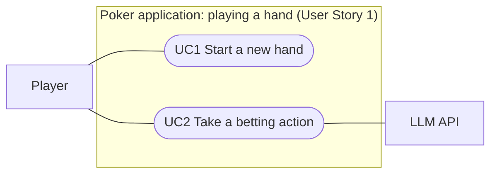
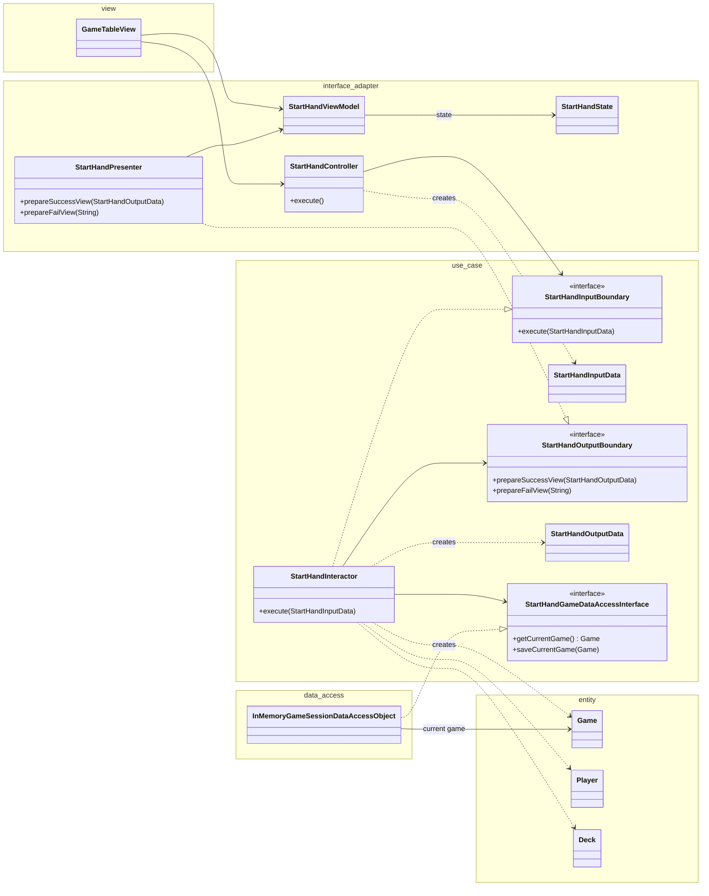
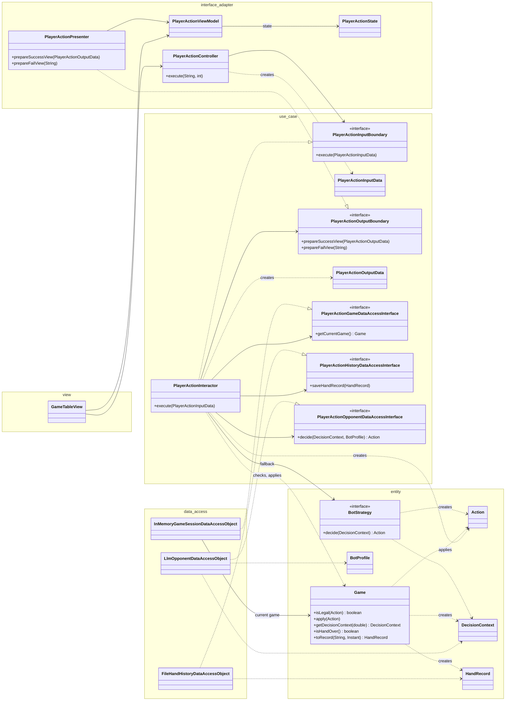
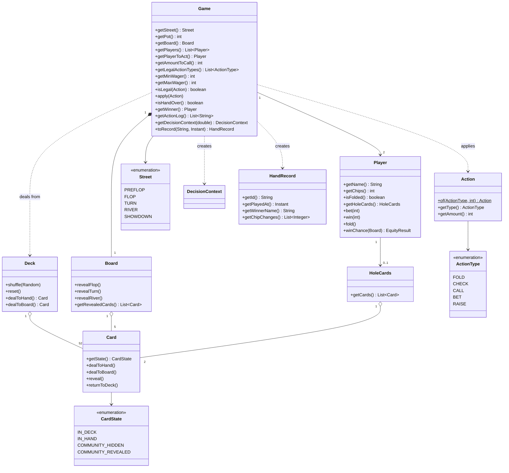
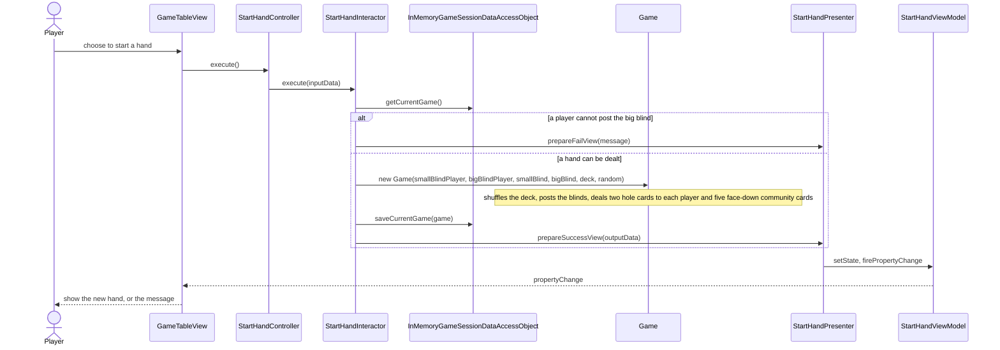
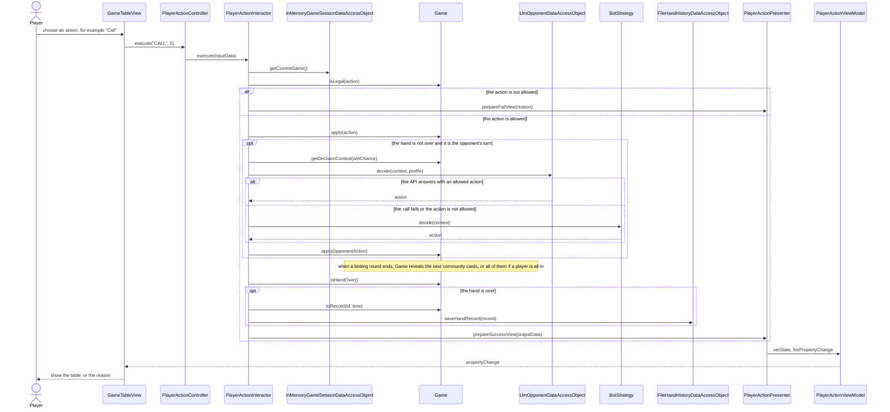
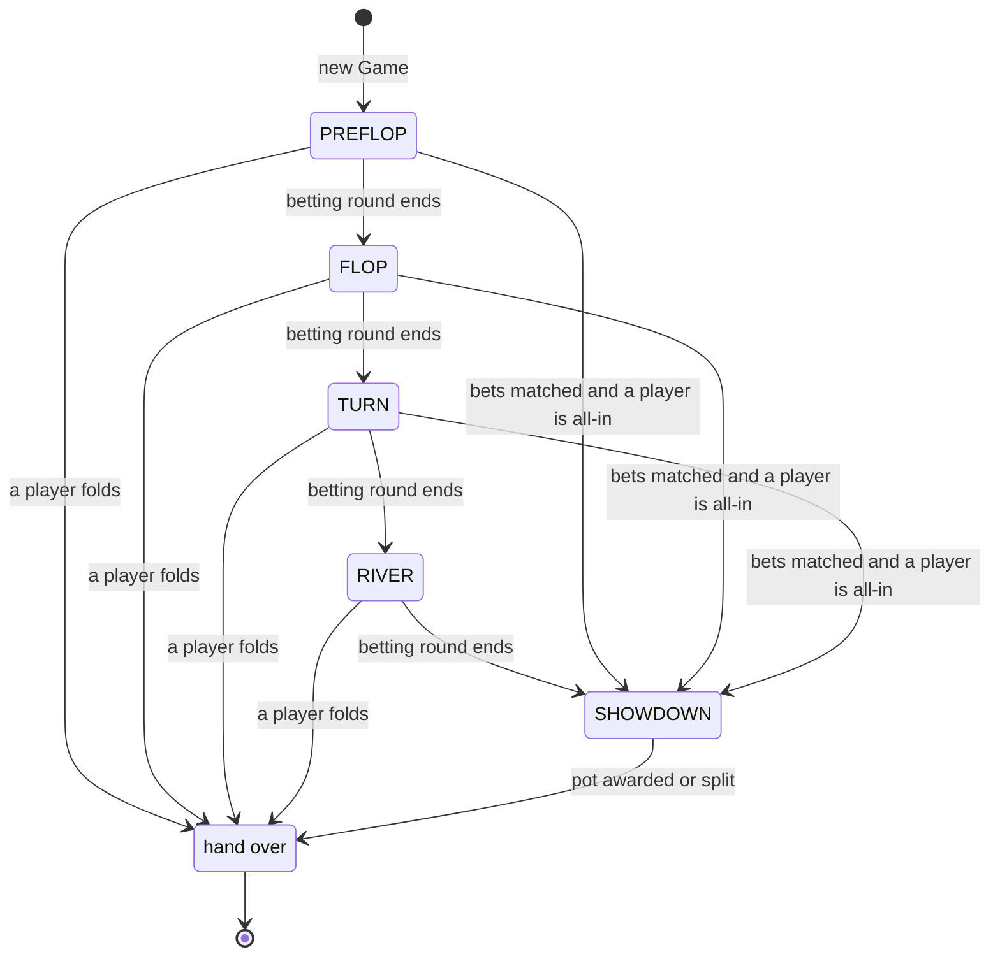
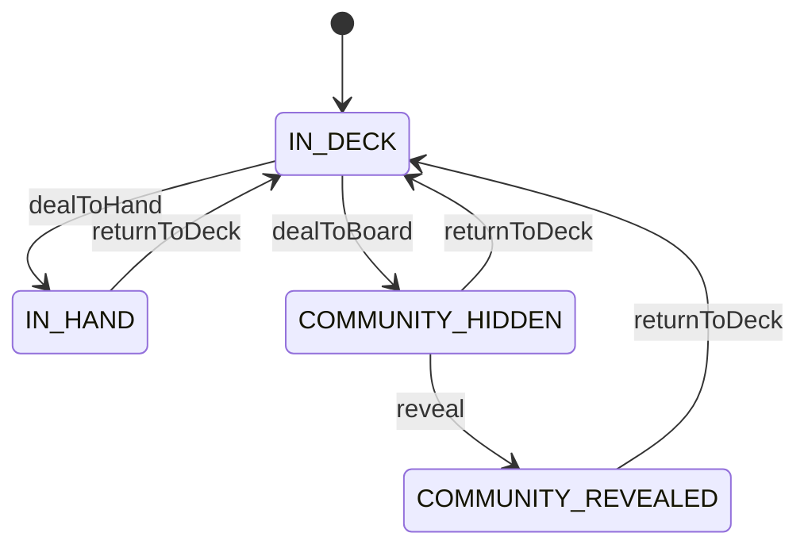

# Use cases 1 and 2: specification and UML

This document gives the full specification and the UML diagrams of the two
use cases of User Story 1, which the README proposes Qijian Yang leads:

- **UC1 — Start a new hand** (package `start_hand`)
- **UC2 — Take a betting action** (package `player_action`)

User Story 1: *as a player, I want to play a game of poker against the
computer so that I can practise without needing other people.* The short
version of every use case is in the [README](../README.md#use-cases), and the
design of the whole program is in [ARCHITECTURE.md](ARCHITECTURE.md).

**What is implemented and what is design.** The entities exist (#7). The
entity class diagram (§3.3) and the two state diagrams (§5) were checked
against the compiled entity classes: every class, method signature, and
relationship drawn there is in the code. The classes of the other layers are
not written yet. Their names follow
[ARCHITECTURE.md, sections 5 and 7](ARCHITECTURE.md#5-package-layout), and the
diagrams that show them (§3.1, §3.2, §4) are the design they will be written
to.

## 1. Use case diagram

The player is the primary actor of both use cases. The LLM API is a
supporting actor of UC2: after the player's action the system asks it for the
computer opponent's action.

## 2. Specifications

### UC1 — Start a new hand

| | |
|---|---|
| **Primary actor** | Player |
| **Trigger** | The player chooses to start a hand on the game screen |
| **Preconditions** | No hand is being played: it is the first hand, or the previous hand is over |
| **Success postconditions** | A new hand is the current game. Both blinds are posted, each player holds two hole cards, and five community cards are dealt face down. The table of the new hand is shown |
| **Data** | The current game is kept in memory by `InMemoryGameSessionDataAccessObject` while the program runs. Nothing is written to a file |

**Main flow**

1. The player chooses to start a hand.
2. The system shuffles the deck, posts the blinds, and deals two hole cards to each player.
3. The system shows the player's cards, both players' chips, the pot, and the actions the player may take.

**Alternative flow**

- **2a. A player does not have enough chips to post the big blind.** No hand is dealt. The system reports that the match is over.

### UC2 — Take a betting action

| | |
|---|---|
| **Primary actor** | Player |
| **Supporting actor** | LLM API |
| **Trigger** | The player chooses fold, check, call, bet, or raise on the game screen, with an amount for a bet or a raise |
| **Preconditions** | A hand is being played and it is the player's turn |
| **Success postconditions** | The player's action and the computer opponent's reply are applied to the hand. Either it is the player's turn again, or the hand is over, the pot is awarded, and a record of the hand is saved |
| **Data** | Reads the current game from memory and the opponent's configuration from `data/bot_profile.json`. Sends a request to the LLM API. When the hand ends, saves a `HandRecord` to `data/hand_history.json` |

**Main flow**

1. The player chooses an action.
2. The system checks that the action is allowed in the current situation.
3. The system applies the action. The computer opponent then acts according to its current configuration.
4. When a betting round ends, the system reveals the next community cards.
5. The system shows the new table.

**Alternative flows**

- **2a. The action is not allowed**, for example a check when there is a bet to call, or a bet or raise outside the smallest and largest amount the rules allow. The system tells the player why and nothing changes.
- **3a. The player folds.** The opponent wins the pot and the hand is over. The computer opponent does not act.
- **3b. The LLM API cannot be reached, takes too long, or answers with an action that is not allowed.** The built-in opponent decides instead.
- **3c. A player is all-in for less than the bet.** The system returns the part of the bet that could not be matched.
- **4a. The bets are matched and a player is all-in.** Nobody can bet any more, so the system reveals all the remaining community cards and goes to the showdown.
- **4b. The last betting round has ended.** The system compares the two hands and awards the pot to the better one. If the hands are equal the pot is split, and an odd chip goes to the big blind.
- **5a. The hand is over**, by a fold or by a showdown. The system announces the winner, awards the pot, and saves a record of the hand.

## 3. Class diagrams

The classes are grouped by the Clean Architecture layer they belong to; the
group names are the top-level packages. A solid arrow means that a class
holds a reference to another, a dashed arrow that it uses or creates it, and
a dashed arrow with a hollow head that it implements an interface.

### 3.1 UC1 — Start a new hand (design)

`StartHandInputBoundary`, `StartHandOutputBoundary`, and
`StartHandGameDataAccessInterface` belong to the use case layer.
`StartHandPresenter` and `InMemoryGameSessionDataAccessObject` are outer-layer
classes that implement them, so every arrow that crosses a layer points
inward.

### 3.2 UC2 — Take a betting action (design)

These are the classes of
[ARCHITECTURE.md, section 7.2](ARCHITECTURE.md#72-class-diagram-for-one-use-case),
grouped by layer, with the entities the interactor works on.

The interactor asks for three things it cannot do itself, each through an
interface of its own: the game being played, a place to keep finished hands,
and the computer opponent's decision. One data access object implements each.

### 3.3 The entities both use cases work on (implemented)

`Deck`, `HoleCards`, and `Board` share the same 52 `Card` objects, which is
why they are drawn as aggregations: dealing a card changes its state and does
not move it. A `HandRecord` keeps cards as text, so it does not change when
the same cards are dealt again in a later hand.

## 4. Sequence diagrams

### 4.1 UC1 — Start a new hand

### 4.2 UC2 — Take a betting action, with its alternative flows

[ARCHITECTURE.md, section 7.3](ARCHITECTURE.md#73-sequence-diagram) shows the
main flow. This diagram adds the alternative flows.

Nothing is returned to the controller: the result reaches the view only
through the output boundary and the view model.

## 5. State diagrams

### 5.1 A hand

The states are the values of `Street`, and "hand over" is the moment
`Game.isHandOver()` becomes true. UC1 creates the hand; every transition
after that is caused by an action applied in UC2.

When the bets are matched and a player is all-in, the remaining community
cards are revealed one street after another without anyone being asked to
act, and the hand goes to the showdown.

### 5.2 A card

Where a card is during a hand is recorded on the card itself, as its
`CardState`. Each method rejects a move that is not allowed from the current
state.

